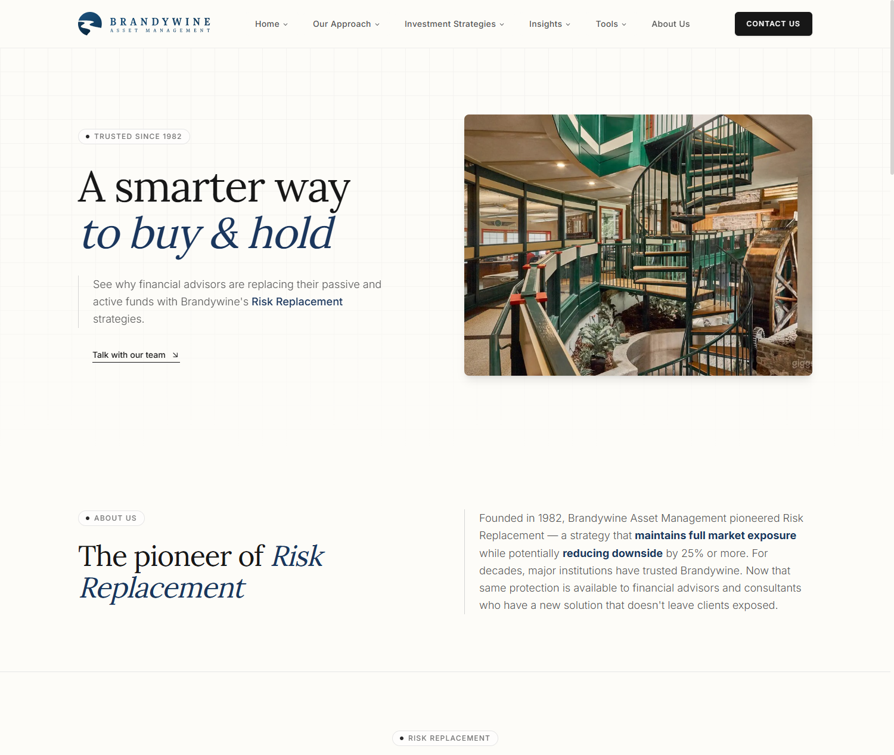

# Brandywine Asset Management — brandywine.com

**Live at [brandywine.com](https://brandywine.com)**

The marketing and content platform for Brandywine Asset Management, an SEC-registered investment adviser founded in 1982 that pioneered Risk Replacement — strategies that keep full benchmark exposure while directly protecting the downside.

## What the site does

- **Interactive Risk Replacement demo**: a live calculator on the homepage that replays historical market periods (e.g. the 2000s "double bear") and shows how a protected strategy compares to naked benchmark exposure, with adjustable starting amount and time horizon
- **Strategy pages** for 14 Risk Replacement strategies (9 Enhanced, 5 Target Date), available as CITs for qualified plans and ETFs
- **Insights engine**: investment commentary and articles, fully editable by the team through a headless CMS
- **Audience-segmented messaging** for financial advisors, retirement plans, and individual investors

## How it's built

- **Next.js + TypeScript** frontend with **Payload CMS** for content, articles, and page editing
- Interactive performance charts driven by real historical strategy data
- SEO via structured metadata and per-page configuration

*The source code is private. This repo is a project showcase.*
